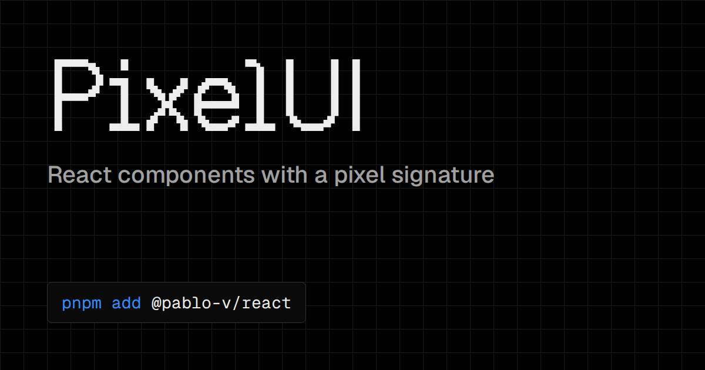

<div align="center">

<a href="https://pabloviniegra.github.io/pixel-ui/">
  
</a>

### React components with a pixel signature

Accessible React 19 components, each published as an independent npm package. PixelUI pairs greyscale surfaces and a single accent with Geist Pixel details, themeable design tokens, and optional pixel effects.

[](https://www.npmjs.com/package/@pablo-v/react)
[](https://github.com/PabloViniegra/pixel-ui/actions/workflows/ci.yml)
[](https://pabloviniegra.github.io/pixel-ui/storybook/)
[](#tailwind-css-v4)
[](LICENSE)

**[Website](https://pabloviniegra.github.io/pixel-ui/)** · **[Storybook](https://pabloviniegra.github.io/pixel-ui/storybook/)** · **[npm packages](https://www.npmjs.com/org/pablo-v)** · **[Changelog](.changeset/README.md)**

</div>

## What’s included

- **64 catalogued components** for forms, navigation, overlays, feedback, data display, and pixel effects. Browse live examples and APIs in [Storybook](https://pabloviniegra.github.io/pixel-ui/storybook/).
- **Use only what you need:** install individual `@pablo-v/*` packages or use the `@pablo-v/react` umbrella package.
- **Themeable foundations:** CSS tokens, Geist / Geist Mono / Geist Pixel fonts, motion, and a Tailwind CSS v4 preset.
- **Accessible interactions:** keyboard navigation, focus handling, and native HTML elements where they fit.
- **MCP server for coding agents:** `@pablo-v/mcp` exposes the component catalogue, typed APIs, examples, and design guidance.

## Packages

The component catalogue is grouped below. The site and Storybook derive their entries from package manifests and stories.

<table>
<tr><th align="left">Foundations</th><th align="left">Purpose</th></tr>
<tr><td><a href="https://www.npmjs.com/package/@pablo-v/tokens"><code>@pablo-v/tokens</code></a></td><td>Design tokens, fonts, motion keyframes, utilities, and Tailwind CSS v4 preset</td></tr>
<tr><td><a href="https://www.npmjs.com/package/@pablo-v/core"><code>@pablo-v/core</code></a></td><td>Internal shared hooks and helpers used by PixelUI packages</td></tr>
<tr><td><a href="https://www.npmjs.com/package/@pablo-v/react"><code>@pablo-v/react</code></a></td><td>Umbrella package re-exporting the component catalogue</td></tr>
<tr><td><a href="https://www.npmjs.com/package/@pablo-v/mcp"><code>@pablo-v/mcp</code></a></td><td>MCP server with component APIs, examples, and design guidance for coding agents</td></tr>
<tr><th align="left" colspan="2">Components</th></tr>
<tr><td><a href="https://www.npmjs.com/package/@pablo-v/avatar"><code>@pablo-v/avatar</code></a></td><td>Photo avatar with initials fallback, presence status and groups</td></tr>
<tr><td><a href="https://www.npmjs.com/package/@pablo-v/badge"><code>@pablo-v/badge</code></a></td><td>Status badge with neutral, accent and status tones and an optional status dot</td></tr>
<tr><td><a href="https://www.npmjs.com/package/@pablo-v/button"><code>@pablo-v/button</code></a></td><td>Button with primary, secondary, ghost and danger variants, three sizes and a loading state</td></tr>
<tr><td><a href="https://www.npmjs.com/package/@pablo-v/card"><code>@pablo-v/card</code></a></td><td>Card container with header, title, description, content and footer slots</td></tr>
<tr><td><a href="https://www.npmjs.com/package/@pablo-v/collapsible"><code>@pablo-v/collapsible</code></a></td><td>Single show/hide disclosure section</td></tr>
<tr><td><a href="https://www.npmjs.com/package/@pablo-v/kbd"><code>@pablo-v/kbd</code></a></td><td>Keyboard key and shortcut display</td></tr>
<tr><td><a href="https://www.npmjs.com/package/@pablo-v/loader"><code>@pablo-v/loader</code></a></td><td>3x3 pixel grid loader with snake, pulse and scan patterns</td></tr>
<tr><td><a href="https://www.npmjs.com/package/@pablo-v/progress"><code>@pablo-v/progress</code></a></td><td>Segmented progress bar with a determinate value or an indeterminate loop</td></tr>
<tr><td><a href="https://www.npmjs.com/package/@pablo-v/resizable"><code>@pablo-v/resizable</code></a></td><td>Resizable panel groups with draggable handles</td></tr>
<tr><td><a href="https://www.npmjs.com/package/@pablo-v/scramble-text"><code>@pablo-v/scramble-text</code></a></td><td>Text that decodes itself from random pixel glyphs</td></tr>
<tr><td><a href="https://www.npmjs.com/package/@pablo-v/scroll-area"><code>@pablo-v/scroll-area</code></a></td><td>Scroll container with thin, themed scrollbars</td></tr>
<tr><td><a href="https://www.npmjs.com/package/@pablo-v/separator"><code>@pablo-v/separator</code></a></td><td>Horizontal and vertical separators</td></tr>
<tr><td><a href="https://www.npmjs.com/package/@pablo-v/skeleton"><code>@pablo-v/skeleton</code></a></td><td>Loading placeholders</td></tr>
<tr><td><a href="https://www.npmjs.com/package/@pablo-v/switch"><code>@pablo-v/switch</code></a></td><td>Toggle switch with role="switch", controlled or uncontrolled, and an optional label</td></tr>
<tr><td><a href="https://www.npmjs.com/package/@pablo-v/timeline"><code>@pablo-v/timeline</code></a></td><td>Vertical list of dated events</td></tr>
<tr><th align="left" colspan="2">Actions</th></tr>
<tr><td><a href="https://www.npmjs.com/package/@pablo-v/chip"><code>@pablo-v/chip</code></a></td><td>Pill chip that can be toggled or removed</td></tr>
<tr><td><a href="https://www.npmjs.com/package/@pablo-v/toggle"><code>@pablo-v/toggle</code></a></td><td>Pressable toggle button, toggle group and segmented control</td></tr>
<tr><th align="left" colspan="2">Forms</th></tr>
<tr><td><a href="https://www.npmjs.com/package/@pablo-v/autocomplete"><code>@pablo-v/autocomplete</code></a></td><td>Combobox that filters a list of options as you type</td></tr>
<tr><td><a href="https://www.npmjs.com/package/@pablo-v/calendar"><code>@pablo-v/calendar</code></a></td><td>Month calendar grid with keyboard navigation and range selection</td></tr>
<tr><td><a href="https://www.npmjs.com/package/@pablo-v/checkbox"><code>@pablo-v/checkbox</code></a></td><td>Checkbox with indeterminate state and pixel check mark</td></tr>
<tr><td><a href="https://www.npmjs.com/package/@pablo-v/color"><code>@pablo-v/color</code></a></td><td>Color area, field, slider, swatch and picker with a pixel grid</td></tr>
<tr><td><a href="https://www.npmjs.com/package/@pablo-v/date-field"><code>@pablo-v/date-field</code></a></td><td>Segmented date input that follows the locale order</td></tr>
<tr><td><a href="https://www.npmjs.com/package/@pablo-v/date-picker"><code>@pablo-v/date-picker</code></a></td><td>Date field with a pop-up calendar</td></tr>
<tr><td><a href="https://www.npmjs.com/package/@pablo-v/date-range-picker"><code>@pablo-v/date-range-picker</code></a></td><td>Start and end date fields with a pop-up range calendar</td></tr>
<tr><td><a href="https://www.npmjs.com/package/@pablo-v/field"><code>@pablo-v/field</code></a></td><td>Form field wrapper with label, description and error</td></tr>
<tr><td><a href="https://www.npmjs.com/package/@pablo-v/file-upload"><code>@pablo-v/file-upload</code></a></td><td>Drag-and-drop file picker with a file list</td></tr>
<tr><td><a href="https://www.npmjs.com/package/@pablo-v/input"><code>@pablo-v/input</code></a></td><td>Text input with prefix and suffix slots</td></tr>
<tr><td><a href="https://www.npmjs.com/package/@pablo-v/multi-select"><code>@pablo-v/multi-select</code></a></td><td>Combobox that picks several options shown as chips</td></tr>
<tr><td><a href="https://www.npmjs.com/package/@pablo-v/number-field"><code>@pablo-v/number-field</code></a></td><td>Numeric input with stepper buttons and keyboard increments</td></tr>
<tr><td><a href="https://www.npmjs.com/package/@pablo-v/pin-input"><code>@pablo-v/pin-input</code></a></td><td>Segmented OTP and PIN code input</td></tr>
<tr><td><a href="https://www.npmjs.com/package/@pablo-v/radio"><code>@pablo-v/radio</code></a></td><td>Radio group with a pixel dot indicator</td></tr>
<tr><td><a href="https://www.npmjs.com/package/@pablo-v/rating"><code>@pablo-v/rating</code></a></td><td>Star rating input and read-only display</td></tr>
<tr><td><a href="https://www.npmjs.com/package/@pablo-v/select"><code>@pablo-v/select</code></a></td><td>Styled native select</td></tr>
<tr><td><a href="https://www.npmjs.com/package/@pablo-v/slider"><code>@pablo-v/slider</code></a></td><td>Range slider drawn as a track of pixel cells</td></tr>
<tr><td><a href="https://www.npmjs.com/package/@pablo-v/textarea"><code>@pablo-v/textarea</code></a></td><td>Multi-line text input with auto-resize</td></tr>
<tr><td><a href="https://www.npmjs.com/package/@pablo-v/time-field"><code>@pablo-v/time-field</code></a></td><td>Segmented time input and time picker</td></tr>
<tr><th align="left" colspan="2">Navigation</th></tr>
<tr><td><a href="https://www.npmjs.com/package/@pablo-v/accordion"><code>@pablo-v/accordion</code></a></td><td>Accordion on native details elements</td></tr>
<tr><td><a href="https://www.npmjs.com/package/@pablo-v/breadcrumb"><code>@pablo-v/breadcrumb</code></a></td><td>Breadcrumb trail for nested pages</td></tr>
<tr><td><a href="https://www.npmjs.com/package/@pablo-v/link"><code>@pablo-v/link</code></a></td><td>Text link with external-link handling</td></tr>
<tr><td><a href="https://www.npmjs.com/package/@pablo-v/navbar"><code>@pablo-v/navbar</code></a></td><td>Site navigation bar with links and disclosure menus</td></tr>
<tr><td><a href="https://www.npmjs.com/package/@pablo-v/pagination"><code>@pablo-v/pagination</code></a></td><td>Page navigation with previous, next and truncated page links</td></tr>
<tr><td><a href="https://www.npmjs.com/package/@pablo-v/sidebar"><code>@pablo-v/sidebar</code></a></td><td>Collapsible application sidebar navigation</td></tr>
<tr><td><a href="https://www.npmjs.com/package/@pablo-v/stepper"><code>@pablo-v/stepper</code></a></td><td>Multi-step progress indicator</td></tr>
<tr><td><a href="https://www.npmjs.com/package/@pablo-v/table"><code>@pablo-v/table</code></a></td><td>Data table primitives</td></tr>
<tr><td><a href="https://www.npmjs.com/package/@pablo-v/tabs"><code>@pablo-v/tabs</code></a></td><td>Tabs with roving focus and a sliding indicator</td></tr>
<tr><td><a href="https://www.npmjs.com/package/@pablo-v/toolbar"><code>@pablo-v/toolbar</code></a></td><td>Grouped controls with roving arrow-key focus</td></tr>
<tr><th align="left" colspan="2">Overlays</th></tr>
<tr><td><a href="https://www.npmjs.com/package/@pablo-v/alert-dialog"><code>@pablo-v/alert-dialog</code></a></td><td>Modal confirmation that requires an explicit choice</td></tr>
<tr><td><a href="https://www.npmjs.com/package/@pablo-v/context-menu"><code>@pablo-v/context-menu</code></a></td><td>Right-click menu built on the menu primitives</td></tr>
<tr><td><a href="https://www.npmjs.com/package/@pablo-v/dialog"><code>@pablo-v/dialog</code></a></td><td>Modal dialog on the native dialog element</td></tr>
<tr><td><a href="https://www.npmjs.com/package/@pablo-v/drawer"><code>@pablo-v/drawer</code></a></td><td>Edge-anchored modal panel on the native dialog element</td></tr>
<tr><td><a href="https://www.npmjs.com/package/@pablo-v/menu"><code>@pablo-v/menu</code></a></td><td>Menu and dropdown with keyboard navigation</td></tr>
<tr><td><a href="https://www.npmjs.com/package/@pablo-v/hover-card"><code>@pablo-v/hover-card</code></a></td><td>Rich preview card shown on hover or focus</td></tr>
<tr><td><a href="https://www.npmjs.com/package/@pablo-v/popover"><code>@pablo-v/popover</code></a></td><td>Non-modal panel anchored to a trigger</td></tr>
<tr><td><a href="https://www.npmjs.com/package/@pablo-v/toast"><code>@pablo-v/toast</code></a></td><td>Toast notifications with a pixel countdown</td></tr>
<tr><td><a href="https://www.npmjs.com/package/@pablo-v/tooltip"><code>@pablo-v/tooltip</code></a></td><td>Hover and focus hint anchored to its trigger</td></tr>
<tr><th align="left" colspan="2">Feedback</th></tr>
<tr><td><a href="https://www.npmjs.com/package/@pablo-v/alert"><code>@pablo-v/alert</code></a></td><td>Inline status message with tone icon, action and dismiss</td></tr>
<tr><th align="left" colspan="2">Signature</th></tr>
<tr><td><a href="https://www.npmjs.com/package/@pablo-v/command-menu"><code>@pablo-v/command-menu</code></a></td><td>⌘K command palette whose results decode in with ScrambleText</td></tr>
<tr><td><a href="https://www.npmjs.com/package/@pablo-v/flip-clock"><code>@pablo-v/flip-clock</code></a></td><td>Flip-clock counter and clock with split-flap digits in the pixel font</td></tr>
<tr><td><a href="https://www.npmjs.com/package/@pablo-v/mini-chart"><code>@pablo-v/mini-chart</code></a></td><td>Sparklines and bar charts drawn in pixel cells</td></tr>
<tr><td><a href="https://www.npmjs.com/package/@pablo-v/pixel-avatar"><code>@pablo-v/pixel-avatar</code></a></td><td>Symmetric pixel identicon generated from a name or email</td></tr>
<tr><td><a href="https://www.npmjs.com/package/@pablo-v/pixel-icons"><code>@pablo-v/pixel-icons</code></a></td><td>16x16 pixel SVG icon set with crisp edges</td></tr>
<tr><td><a href="https://www.npmjs.com/package/@pablo-v/pixel-image"><code>@pablo-v/pixel-image</code></a></td><td>Image that loads as a coarse pixel mosaic and sharpens to full resolution</td></tr>
<tr><td><a href="https://www.npmjs.com/package/@pablo-v/pixel-transition"><code>@pablo-v/pixel-transition</code></a></td><td>Pixel-grid dissolve for the View Transitions API</td></tr>
<tr><td><a href="https://www.npmjs.com/package/@pablo-v/terminal"><code>@pablo-v/terminal</code></a></td><td>Streaming log viewer with autoscroll, level colours and a block cursor</td></tr>
</table>

## Using it

The repository requires **Node.js 22.23.4 or later** and **pnpm 10.28.0**. To use PixelUI in an app, install the umbrella package:

```bash
pnpm add @pablo-v/react
```

Import the bundled styles once, then import components from the umbrella package:

```tsx
import '@pablo-v/react/styles.css';
import { Button } from '@pablo-v/react';

export function DeployButton({ isDeploying }: { isDeploying: boolean }) {
  return (
    <Button variant="primary" loading={isDeploying}>
      Deploy
    </Button>
  );
}
```

You can also install a component separately. Import `@pablo-v/tokens/styles.css` and each component’s `@pablo-v/<name>/style.css` stylesheet alongside its package exports:

```tsx
import '@pablo-v/tokens/styles.css';
import '@pablo-v/button/style.css';
import { Button } from '@pablo-v/button';
```

Set `data-theme="light"` or `data-theme="dark"` on any element to choose a theme; otherwise the theme follows the operating system. Override `--pxl-*` custom properties on `:root` or a container to customize tokens.

### Tailwind CSS v4

Import the PixelUI preset after Tailwind and the design tokens:

```css
@import "tailwindcss";
@import "@pablo-v/tokens/styles.css";
@import "@pablo-v/tokens/tailwind.css";
```

The preset provides utilities such as `font-pixel`, `shadow-pixel`, `clip-notch`, `pixelated`, and token-backed `*-pxl-*` utilities.

### Next.js

For `next/font`, use the token, motion, and utility stylesheets so PixelUI uses the Geist variables defined by your app:

```tsx
import '@pablo-v/tokens/tokens.css';
import '@pablo-v/tokens/motion.css';
import '@pablo-v/tokens/utilities.css';
```

Interactive components include the client boundary directive required by Next.js App Router.

### Coding agent MCP server

Add the PixelUI catalogue to Claude Code:

```bash
claude mcp add pixel-ui -- npx -y @pablo-v/mcp
```

Other stdio-based MCP clients can use this configuration:

```json
{
  "mcpServers": {
    "pixel-ui": { "command": "npx", "args": ["-y", "@pablo-v/mcp"] }
  }
}
```

## Develop the repository

```bash
pnpm install
pnpm storybook       # Storybook at http://localhost:6006
pnpm site            # Astro site at http://localhost:4321/pixel-ui/
```

| Command                             | Purpose                                          |
| ----------------------------------- | ------------------------------------------------ |
| `pnpm build`                        | Build all packages and copy their assets         |
| `pnpm typecheck`                    | Type-check package, app, story, and test sources |
| `pnpm test`                         | Run the Vitest suite                             |
| `pnpm lint`                         | Check the repository with Biome                  |
| `pnpm build-storybook`              | Build the Storybook catalogue                    |
| `pnpm build-site`                   | Build the Astro site                             |
| `pnpm --filter @pablo-v/site check` | Check Astro components and pages                 |
| `pnpm new:component`                | Scaffold a component package                     |
| `pnpm changeset`                    | Record package version bumps for a release       |

## Repository layout

```text
packages/       Independently versioned npm packages
  <component>/  Component source, styles, tests, and Storybook stories
  tokens/       Design tokens, fonts, CSS utilities, and Tailwind preset
  core/         Shared internal helpers
  react/        Umbrella package
  mcp/          MCP server and generated component catalogue
apps/docs/      Storybook configuration and foundations pages
apps/site/      Astro website and component catalogue
scripts/        Build helpers and package scaffolding
.changeset/     Pending package version changes
```

## Releases

Packages are versioned independently with [Changesets](.changeset/README.md). When a component API or recommended usage changes, its package’s usage guide in `packages/mcp/usage/` is updated as part of the change. Component changesets also bump `@pablo-v/mcp` so its published API and usage snapshot stays current.

On pull requests, CI checks formatting, types, tests, package builds, Storybook, and the site. Merging changesets to `main` triggers a version pull request; merging that PR publishes the affected packages to npm. The GitHub Pages workflow publishes the site and Storybook together.

## Fonts and license

PixelUI code is licensed under the [MIT License](LICENSE). Geist, Geist Mono, and Geist Pixel are © Vercel and licensed under the SIL Open Font License 1.1; the font license is included with the font files.

<div align="center">
<br />
<sub>▪ ▪ ▪ &nbsp; made with pixels by <a href="https://github.com/PabloViniegra">@PabloViniegra</a> &nbsp; ▪ ▪ ▪</sub>
</div>
